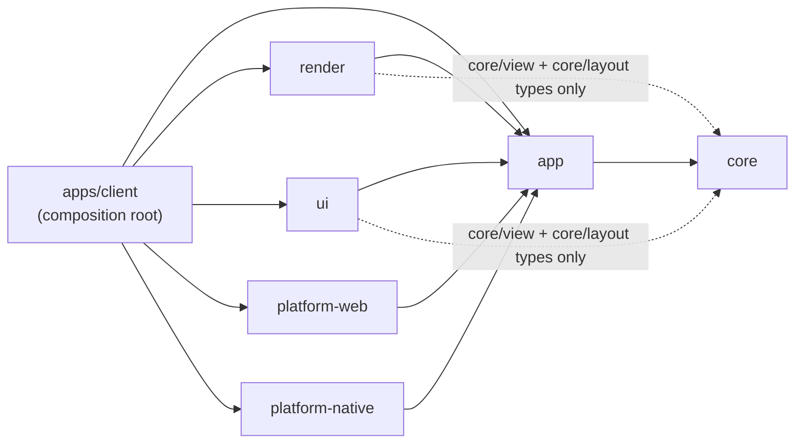
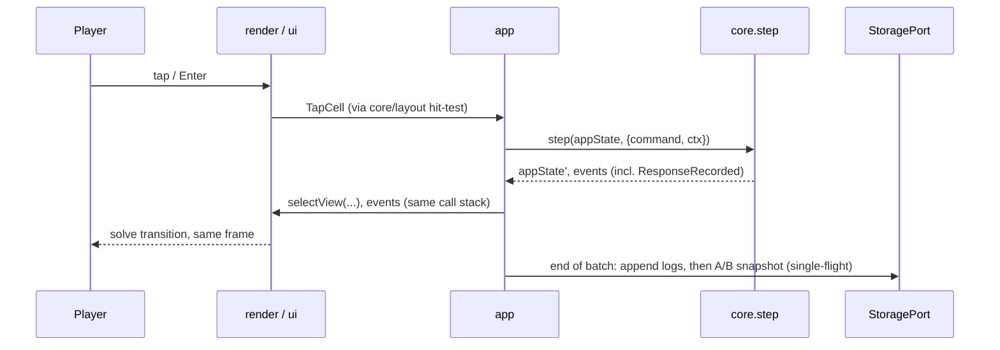
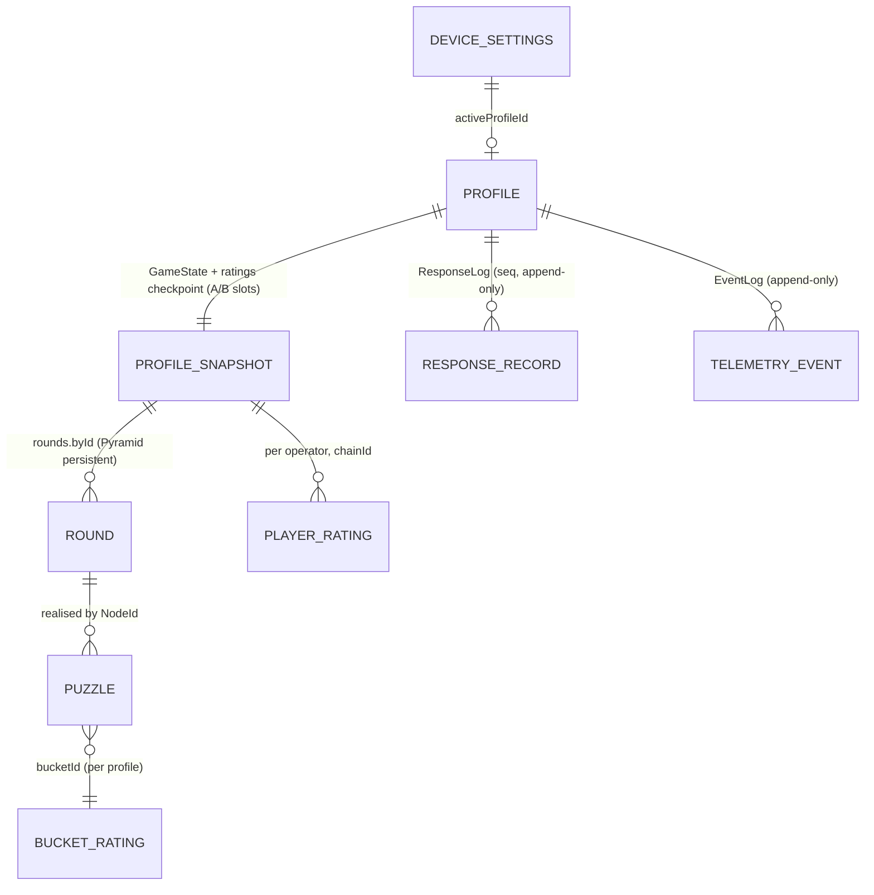
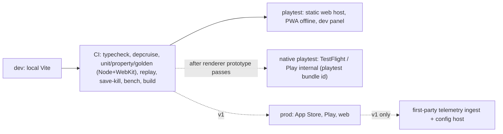

# Architecture Spine: Numception

## Design Paradigm

**Hexagonal (ports and adapters), with a functional core and an imperative shell.**

- **`core`:** the pure, deterministic domain. It holds:
  - the rules, the generator and difficulty
  - ratings and the selector, scoring, and presentation timing
  - view models and layout geometry
  - the save, log and tuning schemas
  - migrations and upcasters

  It does no I/O and reads no clock, ambient randomness, platform, renderer or DOM.
- **`app`:** the imperative shell. It holds the store, synchronous dispatch, the scheduler, the persistence and telemetry pipelines, `FeedbackDirector`, and the port interfaces.
- **Adapters:**
  - `render`: the canvas, for the play view only.
  - `ui`: the DOM overlay and the accessible tree.
  - `platform-web` and `platform-native`.
- **`apps/client`:** the composition root. It wires adapters for each platform and build flavour, and holds the Capacitor project.



## Invariants & Rules

### AD-1: Dependencies point inward; banned dependencies

- **Binds:** all packages; NFR-6; PRD §9.1.
- **Prevents:**
  - game rules leaking into adapters
  - Capacitor or DOM code in the domain
  - an engine swap becoming a rewrite
  - ad, tracking or live-update code slipping in
- **Rule:**
  - Imports follow the diagram and nothing else.
  - `core` imports only its pinned pure dependencies (pure-rand, valibot).
  - Only `platform-native` and `apps/client` may import `@capacitor/*`.
  - Only `render` may import the renderer library, and only `ui` may import Preact.
  - dependency-cruiser enforces these rules in CI, together with a banned list:
    - advertising, attribution and third-party analytics SDKs
    - crash SDKs (POC)
    - live-update or OTA code plugins
    - runtime-loaded remote scripts and third-party font or CDN URLs

### AD-2: One way to change state

- **Binds:** every feature that changes state.
- **Prevents:** two sources of truth, and adapters mutating state or deciding outcomes.
- **Rule:**
  - The store holds one `AppState` (AD-21). It changes only through `core.step(appState, envelope) → { appState, events }`, where the envelope is defined in AD-22.
  - Commands are serialisable and imperative, for example `TapCell`, `Tick`, `Pause`, `Resume`, `SetSetting`, `SwitchProfile`, `SetLevelPin`, `EnterPuzzle`, `ZoomOut`, `StartSession` and `SetActiveTuning`.
  - Events are past tense, for example `PuzzleSolved`, `WrongTap`, `SoftMiss`, `PowerCut`, `RoundCollapsed`, `ResponseRecorded` and `InputDropped`.
  - `app.dispatch` is synchronous. In the same call stack as the input handler, it runs `step` and then hands the events and the new view models to the adapters.
  - Adapters only read view models and react to events. They emit commands; they never mutate state or show an outcome before core's events arrive. A tap-down press ripple is allowed, because it isn't a verdict.

### AD-3: Core is deterministic

- **Binds:** FR-1, FR-2, FR-5, FR-6, FR-32, FR-48; `core`.
- **Prevents:** seeds diverging across platforms or engines; replays and golden seeds drifting.
- **Rule:**
  - `core` never reads `Math.random`, `Date.now`, `performance.now`, locale or env. Time and entropy arrive only in the envelope's `ctx` (AD-22).
  - Generation uses pure-rand in pure style (`purify` or `clone` with integer distributions only). Lint bans `uniformFloat*` and `Math.*` inside `core/generator`.
  - Puzzle values and generation arithmetic use integers or `Rational` only.
  - Floats are allowed only in ratings, probabilities and scores. They reach generation only after being quantised to an integer band.
  - Golden-seed tests run under Node and WebKit (Playwright).

### AD-4: Puzzle addressing, round planning and lazy realisation

- **Binds:** FR-1, FR-2, FR-5, FR-11, FR-12, FR-20, FR-32, FR-48.
- **Prevents:**
  - addresses shifting when the Pyramid grows upward
  - planned rounds that can't ease difficulty
  - each round type addressing puzzles its own way
- **Rule:**
  - **Addressing:** a node is `NodeId = { tier, index }`, bottom-anchored. Tier 1 holds the leaves. The children of `(k, i)` are `(k−1, i·n … i·n+n−1)`. Ids never change once issued.
  - **Seeds:** each profile has a `rootSeed`, created with the profile from ctx entropy. A round's seed is `deriveSeed(rootSeed, roundOrdinal)` for personal rounds and `dailySeed(utcDate)` for the Daily Seed (AD-6).
  - **Round creation:** fixes the round type, `n`, the operator and the pinned tuning. A top-down plan then fixes only each node's **answer contract**: the `c` value it must produce.
  - **Realisation:** a puzzle is realised lazily the first time it is served. The selector picks a band under the fixed `c`. Then `realise(seed, nodeId, spec, versions)` runs, including the seeded placement of cells, and the result plus its selection context (AD-9) are frozen into the round. A realised puzzle is never regenerated during play.

### AD-5: Numbers are exact rationals; core produces display values

- **Binds:** FR-1, FR-3, FR-31, FR-48; save format; NFR-4.
- **Prevents:** data migrations for fractions and negatives; float-equality bugs; the canvas and the accessible tree disagreeing about a value.
- **Rule:**
  - Puzzle values are a normalised `Rational { n, d > 0 }`, serialised as `"n/d"`, or `"n"` when `d = 1`.
  - `core` exports `displayValue(rational, representation) → { glyphs, spoken }`. `render` typesets the glyphs, and `ui` announces `spoken`. Adapters never format values themselves.

### AD-6: Versioned, and every shipped version stays runnable

- **Binds:** FR-6, FR-21, FR-32, FR-44, FR-53; save format; telemetry.
- **Prevents:**
  - mixing incompatible generators or models
  - old logs or Pyramids that can't be regenerated
  - Daily Seed mismatches across app versions
- **Rule:**
  - These integer versions exist: `generatorVersion`, `difficultyModelVersion`, `tuningVersion`, `ratingAlgoVersion`, `selectorVersion`, `saveFormatVersion`, `eventSchemaVersion` and `dailySeedAlgoVersion`.
  - Every realised puzzle and log record carries the relevant versions, plus `appVersion`, `platform` and `flavour`.
  - `core/generator` keeps every shipped `generatorVersion` callable, dispatching by version.
  - Golden-seed fixtures pin the output of each version. Any change to output fails CI unless the version is bumped. A PRNG upgrade counts as an output change.
  - `dailySeed(utcDate) = FNV-1a-32(UTF-8(utcDate ‖ dailySeedSalt))`. The day's generator version is `min(scheduled, highest the client has)`. A client without that version doesn't offer that day's Daily Seed.

### AD-7: Tuning is data, passed in explicitly and pinned per round

- **Binds:** FR-3, FR-15, FR-19, FR-20, FR-22, FR-30, FR-47, FR-52, FR-53.
- **Prevents:** magic numbers; retunes needing code changes; rating updates using a different config from the round; resumed rounds with no config.
- **Rule:**
  - All difficulty, scoring, pacing, presentation-duration, rating and selection parameters live in `TuningConfig` JSON, validated by valibot in `core`. Configs are passed as arguments; there are no globals.
  - Every shipped config stays bundled; CI fails if one is removed.
  - A round pins its `tuningVersion`. That round's scoring and rating updates use the pinned config. The *next* round uses the active config.
  - Changing the active config is the command `SetActiveTuning { version }`.
  - The schema rejects content the build doesn't enable, so there is no × or ÷ in the POC.
  - v1 may fetch new configs as data only.

### AD-8: The response log is the source of truth for ratings

- **Binds:** FR-20, FR-21, FR-22, FR-44; resolves PRD OQ-5 for the POC.
- **Prevents:** data migrations when the rating method changes; the snapshot and log disagreeing; duplicated records.
- **Rule:**
  - `step` emits `ResponseRecorded` carrying the complete `ResponseRecord`:
    - `seq`, which increases monotonically per profile
    - profile and `profileKind`
    - operator, `bucketId`, seed and `nodeId`
    - the cell tapped, the outcome (correct, soft miss or wrong) and `responseMs`
    - session id and position
    - the pre-update ratings, K and the expected P
    - all versions (AD-6), mode, target, and the selection context (AD-9)
  - App appends it to exactly one physical log, `ResponseLog`.
  - Ratings are a projection of that log. The snapshot stores a checkpoint `{ ratings, throughSeq }`. On load, records with `seq > throughSeq` are replayed.
  - Rating keys are `(entityType, entityId, operator, chainId = 0, ratingAlgoVersion)`.
  - `bucketId` embeds `difficultyModelVersion`, so a changed bucket definition gets a new key and starts again from its prior.
  - Bucket ratings are per profile in the POC.
  - The POC ships one K function and one selector, each identified by id in the tuning config.

### AD-9: Every served puzzle records why it was chosen

- **Binds:** FR-20, FR-44, FR-47.
- **Prevents:** being unable to correct for adaptive-selection bias later.
- **Rule:** when a puzzle is realised, the selector returns `{ spec, bucketId, selectorId, selectorVersion, pSelected, exploratory, clamped, forcedBy: 'none'|'levelPin'|'dev' }`. It is frozen on the puzzle and copied into its `ResponseRecord`.

### AD-10: Persistence through one port, crash-safe

- **Binds:** FR-10, FR-12, FR-28, FR-34, FR-38; NFR-2, NFR-3.
- **Prevents:** losing progress to WebView eviction or a mid-write kill; save storms; out-of-order writes; logs drifting from snapshots.
- **Rule:**
  - **Port:** all I/O goes through `StoragePort`. On native, app-private files use `@capacitor/filesystem`, and `@capacitor/preferences` holds `DeviceSettings` only. On web, IndexedDB is used, and `navigator.storage.persist()` is requested.
  - **Atomic snapshots:** each profile's snapshot alternates between two slots, A and B, each carrying `{ generation, checksum }`. Load picks the highest valid slot. A CI test kills the writer partway through.
  - **When to save:** a *batch* is the commands dispatched in one macrotask. A batch is saved if it contains any non-`Tick` command, and on `Pause`. The writer is single-flight and latest-wins.
  - **Write order:**
    1. Append the log records.
    2. Write the snapshot.
    3. Write `DeviceSettings`.
  - **Logs:** append-only segments, never rewritten. Each segment header records its `eventSchemaVersion`. A version bump opens a new segment, and `core` provides pure upcasters applied on read.
  - **Bounded replay:** the snapshot checkpoints the log, and segments before the checkpoint are compacted into an archive that is never replayed on launch.
  - **Snapshots:** `saveFormatVersion` migrations are forward-only. A build never overwrites a save with a newer `saveFormatVersion`; it runs without saving instead.
  - **Profiles:** the profile list is derived from the snapshots that exist.
  - **Delete-all:** write a `wipeInProgress` flag, delete every profile's files and logs, then clear `DeviceSettings`. Boot completes any wipe left pending.
  - Solved Pyramid nodes are stored compactly as their answer and stats only.
  - Save failures retry silently and never block play.

### AD-11: Profiles partition data; the parent gate guards every gated surface

- **Binds:** FR-16, FR-19, FR-34–FR-39, FR-42, FR-46, FR-55.
- **Prevents:** kid and grown-up data mixing; gated surfaces reachable without the gate; per-profile rules scattered across adapters.
- **Rule:**
  - Every persisted record except `DeviceSettings` is keyed by `profileId`.
  - Kid rule variants come only from `profileKind` inside `core`, and reach adapters as explicit view-model fields (AD-13).
  - The gate is an `app`/`ui` flow that guards:
    - switching from Kid to Grown-up
    - For grown-ups
    - external links
    - purchases
    - review prompts
    - platform sign-in
  - `GameServicesPort`, `PurchasePort` and `NotificationPort` are never initialised while a Kid profile is active.
  - The PIN is checked in `app`, salted and hashed with PBKDF2-SHA256 through WebCrypto, with attempt throttling. It never appears in a command or log.

### AD-12: Telemetry has one schema, sessions are explicit, and it never blocks play

- **Binds:** FR-44, FR-45, FR-55; PRD §7; NFR-3.
- **Prevents:** ad-hoc event shapes; diverging session definitions; telemetry hurting play.
- **Rule:**
  - `EventLog` holds the versioned `TelemetryEvent` union from `core` (everything except responses, which live in AD-8's log). Export merges the two by time and `seq`.
  - `app` dispatches `StartSession { sessionId }` on cold start, or on resume after `tuning.sessionGapMs`.
  - Adapter failures become `AppError` events.
  - The POC exports through the dev panel only. In v1, `TelemetryTransport` uploads best-effort, with a policy hook per `profileKind` for the OQ-3 mitigations.
  - The crash signal is `AppError` events plus store vitals; there is no third-party crash SDK in the POC.
  - No free text, names or contact data is ever recorded.

### AD-13: Core owns view models, layout and guide state; canvas draws play, the DOM draws everything else

- **Binds:** FR-8, FR-9, FR-23, FR-38–FR-40; NFR-4.
- **Prevents:**
  - each adapter inventing view-model shapes or branching on rules
  - pointer play and keyboard play diverging
  - drift between the accessible tree and the canvas
  - two owners for the hint, guide or focus
- **Rule:**
  - **View models:** `core/view` exports every type (`PlayVM`, `A11yTreeVM`, `GuideVM`, `ControlSurfaceVM`, `StatsVM`, `RoundEndVM`, `MiniMapVM`) and one function, `selectView(appState, tuning, catalog, transient)`.
  - **Adapters:** may lay out and format, but never branch on `profileKind`, mode or tuning. Every such decision is an explicit view-model field, for example `powerCutCue: 'soft'|'full'` or `inputLocked`.
  - **Layout:** `core/layout` provides pure cell geometry in normalised coordinates for every shape. `render` uses it for hit-testing and drawing, and `ui` uses it for keyboard focus order and the accessible tree.
  - **Guide state:** `core` owns `GuideState` (the line, the hint timing from `Tick`, and the ghost-finger target). `ui` renders the text with aria-live. `render` draws the ghost finger and the focus ring from `PlayVM`, while `focusedCell` is transient state in `app`.
  - **Stats:** incremental aggregates in `GameState.stats` (daily buckets kept for 30 days, plus all-time). Stats never read the logs.

### AD-14: The renderer port contract

- **Binds:** FR-9, FR-25, FR-26; NFR-1.
- **Prevents:** engine lock-in; the renderer holding truth; optimistic verdicts.
- **Rule:**
  - `render` implements `RenderPort { mount(el), render(playVM), play(events), hitTest(point) → NodeCellRef | null, destroy() }`. The theme comes from `playVM`, so there is no separate theme channel.
  - `hitTest` returns `null` whenever `playVM.inputLocked` is set.
  - `render` plays transitions to the durations given by `PlayVM`, and snaps to the end state when the presentation is `idle`.
  - It rebuilds entirely from the current view model after a lost WebGL context, a resume or a reload.
  - It may use frame time for interpolation only.
  - The first visible response to a tap renders in the same frame (≤ 100 ms, NFR-1).

### AD-15: Themes and transitions are data; core chooses them

- **Binds:** FR-25–FR-27; NFR-4.
- **Prevents:** colours or fonts hard-coded in the renderer; the theme changing on resume; two places that pick the next theme.
- **Rule:**
  - A theme is token JSON covering the full UX role grammar: colours for every cell state including the Kid variants, typography, stroke and join, glow, inset and texture refs.
  - Transitions are registered by id, with tags (`calm`/`intense`, `on-tap`/`after-tap`), `maxFlashesPerSecond` and an optional audio cue id.
  - When a round is created, `core.selectPresentation(state, tuning, catalogIds, rng)` picks `{ themeId, transitionId }`, filtered by mode, Motion and profile, and stores the choice on the round.
  - `render` resolves ids to tokens. Fonts are self-hosted and preloaded before the first draw.
  - CI checks contrast and colour-vision safety for every theme, including the extremes of combo heat and the Kid variants.

### AD-16: Platform capabilities are ports; one feedback director

- **Binds:** FR-40–FR-43, FR-45, FR-46, FR-55; NFR-4, NFR-5.
- **Prevents:** scattered Capacitor calls; sounds playing twice or never; ignored OS preferences.
- **Rule:**
  - **Ports**, each with web and native adapters chosen in `apps/client`: `StoragePort`, `AudioPort`, `HapticsPort`, `SharePort`, `LifecyclePort`, `AccessibilityPrefsPort` (Reduce Motion, text size), `TelemetryTransport`, `GameServicesPort`, `PurchasePort` and `NotificationPort`.
  - Every feature works with no-op adapters.
  - **Audio** respects the iOS mute switch: an ambient audio session, verified on a device.
  - **Feedback:** `FeedbackDirector` in `app` is the only mapper from events plus `PlayVM` to `AudioPort` and `HapticsPort` calls, gated by profile settings.
  - **Lifecycle:** `LifecyclePort` emits `Pause { lifecycle }` and `Resume { lifecycle }`.

### AD-17: Time comes from the shell; pauses are a set

- **Binds:** FR-10, FR-15, FR-16, FR-19, FR-23, FR-28, FR-40.
- **Prevents:** drifting timers; pause sources cancelling each other; adapters running game-meaningful timers.
- **Rule:**
  - The scheduler in `app` is the only clock reader for game-meaningful time. It dispatches `Tick { elapsedMs }` in every mode while `pauseReasons` is empty.
  - `GameState.pauseReasons` is a set of `lifecycle`, `panel`, `gate` and `blur`.
  - Commands are `Pause { reason }` and `Resume { reason }`.
  - The first `TapCell` while `blur` is set clears the blur and is neither scored nor logged as a response. The accessible tree hides cell values while the board is blurred.
  - The daily-streak date comes from `ctx.localDate`.

### AD-18: Build flavours and the release envelope

- **Binds:** FR-44, FR-53; NFR-6; environments.
- **Prevents:** dev tooling shipping to players; dev actions bypassing the store; flavours colliding on devices; code changing outside the stores.
- **Rule:**
  - **Flavours:** `dev`, `playtest` and `prod`, chosen at build time in `apps/client`, each with its own bundle id (`…numception.dev`, `…numception.playtest` and the store id).
  - **Dev panel** (dev and playtest only; tree-shaken out of prod): tuning switcher, telemetry export, seed and `NodeId` inspector, level-pin override. Every dev action is a normal command with `source: 'dev'`.
  - Rules, generator and tuning are identical across flavours.
  - Code reaches native players only through store builds, never over the air.
  - **Web hosting:** the web build sets only strictly necessary cookies (none in the POC) and makes no third-party runtime requests.

### AD-19: Tests are part of the contract

- **Binds:** FR-1, FR-2, FR-6; NFR-1; `core`.
- **Prevents:** regressions in uniqueness, determinism, performance or crash safety.
- **Rule:** CI runs, on every change:
  - property tests (fast-check):
    - exactly one valid triple for every `n` and enabled operator
    - for every band and answer contract, a puzzle exists or the band is clamped with the clamp recorded
  - round-consistency tests across tiers
  - golden seeds under Node and WebKit (AD-3, AD-6)
  - a replay test: `step` folded over a recorded `CommandLog` reproduces the snapshot
  - the save-kill test (AD-10)
  - boundary lint (AD-1)
  - a generator benchmark gate on the CI baseline: realisation p95 ≤ 10 ms per node, and a round plan ≤ 50 ms

  The PRD's 100,000-puzzle check runs nightly. Realisation retries are bounded, with a fallback to a lower band.

### AD-20: The presentation timeline is state

- **Binds:** FR-8, FR-9, FR-10, FR-14–FR-17, FR-21.
- **Prevents:** taps landing on the next tier during a collapse; timers draining during animations; resume differences; solve times inflated by motion settings.
- **Rule:**
  - `Round.presentation = { kind: 'idle'|'solve'|'collapse'|'themeChange'|'powerCut', startedAtMs, durationMs, transitionId }`. Durations come from the pinned tuning and the Motion level, and the timeline is advanced only by `Tick`.
  - `core` drops `TapCell` unless `kind === 'idle'`, and emits `InputDropped` (telemetry only).
  - The chain window and round time freeze during `collapse` and `themeChange`; tuning decides whether they run during `solve`.
  - `responseMs` is `Tick` time from `idle` to the tap, excluding paused time.
  - On resume, any non-idle presentation completes to its end state.
  - Wrong taps within the tuning merge window (700 ms) coalesce into one `PowerCut`. Every tap is still logged.

### AD-21: State root and settings scope

- **Binds:** FR-18, FR-19, FR-34, FR-40, FR-47.
- **Prevents:** settings stored per profile in one feature and per device in another; `SwitchProfile` having no reducer.
- **Rule:**
  - `AppState = { device: DeviceState, profiles: { [profileId]: GameState }, activeProfileId }`.
  - Device-scoped commands (`SwitchProfile`, `SetPin`, `SetDeviceSetting`) have their own reducer. Profile-scoped commands route to the active profile.
  - **Per-profile settings:** mode, levelPin, chainWindow, motion, themeSelection, playlist, effects, music, haptics.
  - **Per-device settings:** activeProfileId, pinHash, wipeInProgress, OS-preference override.
  - A new setting must be added to this list. Kid defaults (Calm, Relaxed) are applied when a profile is created.

### AD-22: The command envelope carries time and entropy

- **Binds:** FR-5, FR-6, FR-10; AD-3, AD-19.
- **Prevents:** core needing ids or seeds it can't create; two id schemes; an unreplayable history.
- **Rule:**
  - Every dispatch is `{ command, ctx: { nowMs, localDate, utcDate, entropy: { ids: Ulid[2], seed32: int[2] } } }`.
  - `app` refills the entropy pool on every command, and `core` takes ids and new `rootSeed`s only from it. Puzzle seeds come only from AD-4 derivation, never from ctx entropy.
  - Dev and playtest builds persist each profile's envelopes as a `CommandLog` segment, used for replay tests and bug repros.

### AD-23: Flash budget

- **Binds:** FR-16, FR-17, FR-26; NFR-4.
- **Prevents:** the canvas and the DOM each staying under the flash limit while together exceeding it; behaviour merges being implemented twice.
- **Rule:**
  - Merges that change behaviour (power-cut coalescing, combo steps) live only in `core` (AD-20).
  - Every luminance change over the threshold goes through one `FlashBudget` in `render`, capped at 3 per second across all sources.
  - `ui` never animates luminance or colour over the play view. The round-end flash content is `ui`, but its backdrop flash comes from `render`.
  - CI sums each transition's `maxFlashesPerSecond` with the concurrent effects.

### AD-24: Round types and per-round mode

- **Binds:** FR-11–FR-19, FR-32, FR-49–FR-52, FR-54.
- **Prevents:**
  - round types sharing one state shape
  - combo state living in two places
  - a mode switch corrupting a half-scored round
  - the Pyramid being overwritten by other rounds
- **Rule:**
  - `GameState.rounds = { activeRoundId, byId }`.
  - `Round` is a discriminated union (`classic | tower | pyramid | rapidFire | daily`) over `RoundCore { roundId, type, seed, mode, tuningVersion, presentation, viewPath, modeState }`.
  - Combo, the chain window, totems and Overdrive live in `modeState`.
  - A `RoundType` registry in `core` provides `{ plan, realise, onSolve, isComplete }`.
  - Mode is pinned per round: `SetSetting(mode)` takes effect at the next round. [ASSUMPTION]
  - The Pyramid is one persistent round that other round types never overwrite.

### AD-25: Navigation is state

- **Binds:** FR-7, FR-9, FR-12; PRD OQ-8.
- **Prevents:** the puzzle in view living only in `render`; resume landing on a different view; keyboard and pointer navigation diverging.
- **Rule:**
  - `RoundCore.viewPath` (a `NodeId` stack) is the puzzle in view.
  - `EnterPuzzle { nodeId }` and `ZoomOut` are commands.
  - After a solve, `core` auto-advances to the next unsolved sibling. A tap on an unsolved cell in an overview enters that puzzle (POC default).
  - `MiniMapVM` (v1) is derived from `viewPath`.

## Consistency Conventions

| Concern | Convention |
| --- | --- |
| Naming | Packages `@numception/<name>`. Types `PascalCase`; functions `camelCase`. Commands are imperative and events past tense (AD-2). Glossary terms from PRD §3 verbatim (`tier`, `round`, `chainWindow`, `softMiss`, `powerCut`, `levelPin`, `constellation`); no synonyms. |
| Files | `kebab-case.ts`; one exported concept per file in `core`; `*.test.ts` beside the source; property tests are `*.prop.test.ts`. |
| IDs | `profileId`, `sessionId` and `roundId` are ULIDs taken from `ctx.entropy` (AD-22). `NodeId` follows AD-4. `bucketId` is canonical, e.g. `dm1|add|d2|c1|n5|nm1`, with the leading `dm<difficultyModelVersion>`. `seq` is a per-profile monotonic integer. |
| Data formats | JSON. Puzzle values are `Rational` strings (AD-5). Times are integer ms. Dates are ISO `YYYY-MM-DD`: local for the streak, UTC for the Daily Seed. Every persisted document and log segment header carries `{ kind, schemaVersion }`. |
| Errors | `core` returns `Result<T, DomainError>` with a discriminated `code` and never throws on game input. The shell records adapter failures as `AppError` events and degrades silently, with no error dialogs during play. |
| Config access | Only `TuningConfig` (AD-7) and `AppState.device` (AD-21). No `import.meta.env` reads outside `apps/client`. |
| UI state | Preact signals are derived from view models only. Components hold only transient UI state (open or closed, hover). |
| Logging | Console output only in `dev`. |
| Accessibility | Every interactive DOM element has an accessible name. Every canvas cell has an accessible-tree twin built from `A11yTreeVM` (AD-13). |
| TypeScript | One shared `tsconfig.base.json` sets `strict`, `module` and `target` explicitly (TS 6 changed the defaults). |

## Stack

Verified 2026-10-09 (`research-stack-versions.md`, plus npm checks recorded in the memlog).

| Name | Version |
| --- | --- |
| Node | 24 LTS |
| pnpm (workspaces; config in `pnpm-workspace.yaml`) | 11.x (repo `devEngines`) |
| TypeScript | 6.0.x |
| Vite | 8.3.x |
| @preact/preset-vite | 2.10.x |
| vite-plugin-pwa (Workbox 7.4.x) | 1.3.x |
| Vitest | 5.0.x |
| fast-check | 4.10.x |
| @playwright/test | 1.64.x |
| dependency-cruiser | 18.5.x |
| pure-rand | 8.4.2 (exact) |
| valibot | 1.5.x |
| preact / @preact/signals | 10.29.x / 2.11.x |
| idb (web storage) | 8.0.x |
| @capacitor/core, cli, ios, android | 8.5.x |
| @capacitor/filesystem · preferences · haptics · share · app | 8.1.x · 8.0.x · 8.0.x · 8.0.x · 8.1.x |
| Renderer (prototype decides) | phaser 4.2.x **or** pixi.js 8.22.x + pixi-filters 6.1.x |
| Platform floor | iOS 15+, Android minSdk 24, WebGL 2 baseline |

## Structural Seed

```text
numception/
  package.json  pnpm-workspace.yaml  tsconfig.base.json  .dependency-cruiser.cjs
  packages/
    core/        # generator (by version), layout, rules, rounds, difficulty, ratings, selector,
                 #   scoring, presentation, view, schemas, migrations, upcasters
      test/fixtures/golden-seeds/
    app/         # store, dispatch, scheduler, persistence + telemetry pipelines, FeedbackDirector, gate, ports
    render/      # RenderPort impl, FlashBudget, theme/transition runtime
    ui/          # Preact overlay: control surface, stats, guide, gate, a11y tree, dev panel
    platform-web/     # IndexedDB, Web Audio, Web Share, visibility, prefers-reduced-motion
    platform-native/  # Capacitor adapters
  content/
    tuning/            # TuningConfig JSON, one per tuningVersion, never deleted
    themes/  transitions/  fonts/
  apps/client/         # composition root, flavours, PWA config, capacitor.config.ts, ios/, android/
  prototypes/renderer-bakeoff/   # throwaway; never imported by packages/
```

**Runtime flow**



**Persisted data**



**Deployment and environments**



- **POC:** no backend. A static host serves the playtest PWA. [ASSUMPTION: Cloudflare Pages, GitHub Pages or similar.]
- **CI:** [ASSUMPTION: GitHub Actions.]
- **Dependency updates:** dependencies are pinned through the lockfile, and updates are batched (for example by Renovate or Dependabot). A PRNG or generator-affecting update needs a version bump (AD-6).
- **v1:** the only backend is the telemetry ingest plus a config host. There is no game server. Leaderboards use Game Center and Play Games.

## Capability → Architecture Map

| Capability / Area (PRD) | Lives in | Governed by |
| --- | --- | --- |
| Generation, rules, soft miss, fractions (FR-1–6, FR-48) | `core/generator`, `core/rules`, `core/layout` | AD-3, AD-4, AD-5, AD-6, AD-19 |
| Play loop, input, resume, navigation (FR-7–10) | `core.step`, `core/presentation`, `app`, `render` | AD-2, AD-10, AD-14, AD-17, AD-20, AD-25 |
| Round types, Pyramid, Rapid Fire, entry points, power grid (FR-11–13, FR-49, FR-54) | `core/rounds`, `ui` | AD-4, AD-24, AD-25 |
| Zen and Normal, scoring, combo, Overdrive, clean bonus (FR-14–19, FR-50–52) | `core/rounds` `modeState`, `core/scoring` | AD-7, AD-20, AD-23, AD-24 |
| Adaptive difficulty, ratings, mastery, level pin, tuning (FR-20–22, FR-47, FR-53) | `core/difficulty`, `core/ratings`, `core/selector`, `content/tuning` | AD-7, AD-8, AD-9, AD-21 |
| Onboarding, content introduction (FR-23–24) | `core` `GuideState`, `ui`, `render` | AD-13, AD-20 |
| Themes and transitions (FR-25–27) | `content/`, `core.selectPresentation`, `render` | AD-15, AD-23 |
| Streak, freezes, hints, dot faces (FR-28–31) | `core/progression`, `core.displayValue` | AD-5, AD-17 |
| Daily Seed and share (FR-32–33) | `core/seeds`, `SharePort` | AD-4, AD-6, AD-16 |
| Profiles, gate, kid safety, notifications (FR-34–38, FR-55) | `core` device reducer, `app` gate, `ui` | AD-10, AD-11, AD-21 |
| Stats (FR-39) | `GameState.stats`, `core/view` | AD-13 |
| Control surface (FR-40) | `ui` from `ControlSurfaceVM` | AD-13, AD-21 |
| Sound and haptics (FR-41) | `FeedbackDirector`, `AudioPort`, `HapticsPort` | AD-16 |
| Leaderboards, native behaviours (FR-42–43) | `GameServicesPort`, `platform-native` | AD-11, AD-16 |
| Telemetry (FR-44–45) | `core/telemetry`, `app` pipeline, `TelemetryTransport` | AD-8, AD-9, AD-12 |
| Monetization (FR-46) | `PurchasePort` (v1) | AD-11, AD-16 |
| Performance, offline, accessibility, parity, store (NFR-1–6) | all | AD-1, AD-10, AD-13, AD-14, AD-18, AD-19, AD-23 |

## Deferred

- **Renderer: Phaser 4 or PixiJS v8.** Decided by `prototypes/renderer-bakeoff`. The test scene is neon lines, glow, 200 particles, a tier zoom and a round collapse. Measure fps, gzipped size and cold start on a Galaxy A35-class phone and an iPhone 13. Tie-break: control of the render loop first, then size, then cold start. AD-14 keeps the choice local to `render`.
- **Formula constants** (K, selector, scoring, durations). These live in `TuningConfig` (AD-7) and the PRD addendum §A2.
- **Multiple rating chains, propensity-corrected recalibration, and device-wide bucket ratings.** AD-8 and AD-9 let all three be added later without a data migration.
- **Upward generation for the endless Pyramid** (PRD OQ-4). This means choosing a new top's answer contract around the existing top's answer. Bottom-anchored addressing (AD-4) is already in place. Deferred to the v1 Pyramid epic.
- **Telemetry ingest provider and API, push provider, purchase plugin, Game Center plugin** (a custom thin plugin; there is no maintained Capacitor 8 plugin). All v1, each behind its port.
- **Seed and share link format and deep-link handling** (v1, FR-33). It is limited by AD-6 (seeds carry puzzle content only) and AD-11.
- **Backup and restore across devices** (PRD OQ-18). Snapshots and logs are already portable JSON.
- **Remote tuning delivery** (v1). Only the data-only and pinning rules (AD-7) are fixed now.
- **Upgrading to TypeScript 7, Preact 11 or vite-plugin-pwa 2.** Once the ecosystem settles.
- **Music and the pack audio slot.** Beyond the `AudioPort` interface.
- **Layout breakpoints and phone landscape** (PRD OQ-14). Owned by UX, inside `core/layout`, `ui` and `render`.
